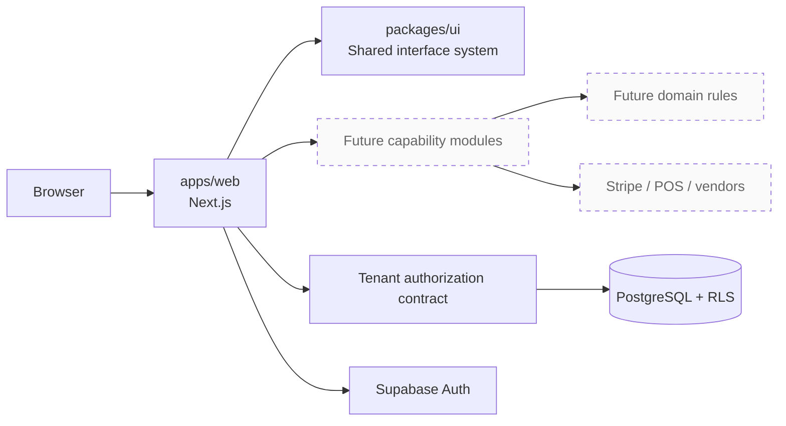
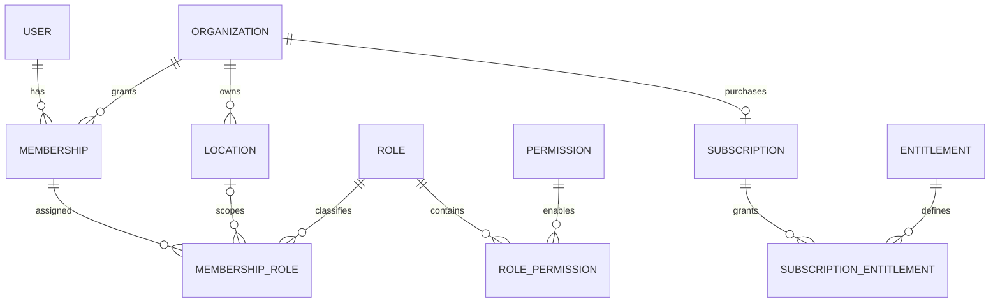

# Restaurant SaaS Architecture v1.0

## Purpose

This document records the approved architecture as implementation constraints. The product is a commercial, multi-tenant restaurant operations platform for companies with one or more locations. Planned capabilities include recipes, food costing, inventory, purchasing, POS integrations, and subscription billing.

Milestones 1 through 3 establish the delivery foundation, tenant data boundary, authenticated request boundary, and organization shell. Operational capabilities and external billing synchronization remain later milestones.

## System shape

The application is a modular monolith: one web deployment and one transactional database, divided into capability modules with explicit contracts. This avoids premature distributed-system complexity while preserving seams for future extraction.

Dashed nodes remain planned. Supabase Auth, user-scoped server clients, the PostgreSQL tenant model, and reviewed tenant workflow functions are implemented.

## Current package boundaries

| Workspace                    | Responsibility                                                        | May depend on                            |
| ---------------------------- | --------------------------------------------------------------------- | ---------------------------------------- |
| `apps/web`                   | SSR auth, routing, server actions, tenant context, and UI composition | `packages/ui`, Supabase client libraries |
| `packages/ui`                | Reusable accessible primitives, design tokens, shared CSS             | React and presentation-only libraries    |
| `packages/typescript-config` | Strict compiler policy                                                | Nothing at runtime                       |

Future domain and infrastructure packages must be proposed when their milestone begins. They are not pre-created as empty shells because package boundaries should follow approved, testable responsibilities.

## Dependency rules

1. Dependencies point inward: UI/framework and integration code may depend on application contracts; domain rules do not depend on frameworks or vendors.
2. Workspace consumers import only exported package entry points.
3. Server code owns secrets and privileged clients. Client components receive only the minimum serializable data needed to render.
4. Cross-module writes go through the owning module's service contract, not directly to its tables.
5. External integrations enter through adapters and idempotent jobs, never through vendor-shaped types in core domain logic.

## Tenant model

The organization is the tenant. A location belongs to exactly one organization. A user may belong to multiple organizations through memberships and may receive organization- or location-scoped roles. Permissions are named capabilities. Subscription entitlements constrain commercial access independently from staff permissions.

The physical schema is implemented under `supabase/migrations`. Tenant-owned rows carry `organization_id`; composite foreign keys prevent a membership, role, location, subscription, or entitlement row from being attached across organizations. Profiles use the Supabase Auth user identifier as their primary and foreign key.

Roles are organization-owned and can be organization- or location-scoped through role assignments. Permission definitions are global capability names. Plans and entitlement definitions are global commercial configuration; subscriptions and effective subscription entitlements are tenant-owned snapshots. Monetary values use `numeric(12,2)`, and quantity limits use `numeric(20,6)`.

## Request authorization

For a tenant-scoped server request:

1. Refresh SSR cookies in Next.js Proxy and validate the user with `getUser()` at server actions/pages (`getClaims()` is used for the optimistic route boundary).
2. Treat organization and location cookies as untrusted selectors; resolve them against active membership and RLS-visible rows.
3. Confirm active membership and location access.
4. Evaluate the named permission.
5. Evaluate any required subscription entitlement.
6. Execute through a user-scoped database connection so the implemented PostgreSQL RLS policies provide the final tenant boundary.

A service-role connection must never replace this path for ordinary user requests. Security-definer helpers live in the unexposed `private` schema, pin an empty search path, filter on `auth.uid()`, and are callable only by `authenticated` where required by policy evaluation.

Onboarding and invitation acceptance are public-schema RPC entry points because PostgREST exposes the public schema. They are security-definer functions with empty search paths, explicit execute grants, verified-email checks, permission checks, tenant-consistent foreign keys, and transactional writes. Plaintext invitation tokens are returned once; only SHA-256 digests are persisted.

## Exact numbers

Money, recipe quantities, yields, unit conversions, inventory counts, and costs require exact decimal semantics. PostgreSQL `numeric` is the target persistence type. API payloads use decimal strings; application calculations use an approved decimal library. JavaScript `number` is limited to values where binary floating-point behavior is acceptable and must not perform financial or quantity arithmetic.

## Deployment baseline

- Next.js App Router application with standalone output
- PostgreSQL with RLS and Supabase Auth identity linkage
- Stripe subscriptions and signed webhooks in a later billing milestone
- pnpm workspaces and Turborepo for local orchestration
- GitHub Actions for formatting, linting, type checks, tests, and production builds
- Environment-specific secrets supplied by the deployment platform, never committed

## Primary risks

| Risk                                  | Architectural response                                                                                 |
| ------------------------------------- | ------------------------------------------------------------------------------------------------------ |
| Cross-tenant data exposure            | PostgreSQL RLS, server authorization, deny-by-default policies, and adversarial isolation tests        |
| Incorrect food-cost arithmetic        | Exact decimal types, unit normalization, explicit rounding policy, and golden calculation tests        |
| Permission/entitlement drift          | Central capability names, server checks, auditable role mappings, and separate commercial entitlements |
| Integration duplication or reordering | Idempotency keys, inbox/outbox patterns, retries, reconciliation, and observable job state             |
| Over-coupled modules                  | Public package entry points, dependency-direction rules, and ownership of writes                       |
| Premature scope expansion             | Milestone gates and approval before database or domain implementation                                  |

## Architecture acceptance rules

No tenant-aware capability is complete until database isolation and server authorization are both verified. No costing capability is complete until exact-number behavior and rounding rules are tested. No integration is complete until authentication, idempotency, retries, and reconciliation behavior are verified.
