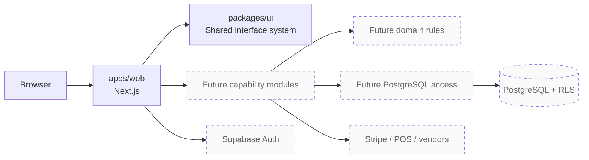
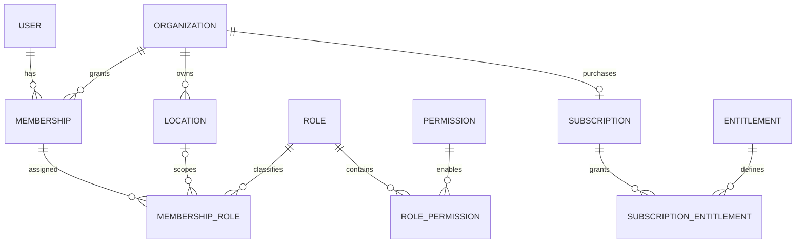

# Restaurant SaaS Architecture v1.0

## Purpose

This document records the approved architecture as implementation constraints. The product is a commercial, multi-tenant restaurant operations platform for companies with one or more locations. Planned capabilities include recipes, food costing, inventory, purchasing, POS integrations, and subscription billing.

Milestone 1 establishes only the delivery foundation. Sections describing data, authentication, and tenant isolation are target-state decisions for later approved milestones, not evidence that those features exist today.

## System shape

The application is a modular monolith: one web deployment and one transactional database, divided into capability modules with explicit contracts. This avoids premature distributed-system complexity while preserving seams for future extraction.

Dashed nodes are planned and intentionally absent from Milestone 1.

## Current package boundaries

| Workspace                    | Responsibility                                                      | May depend on                             |
| ---------------------------- | ------------------------------------------------------------------- | ----------------------------------------- |
| `apps/web`                   | Routing, server-rendered UI, composition, future request boundaries | `packages/ui`, future application modules |
| `packages/ui`                | Reusable accessible primitives, design tokens, shared CSS           | React and presentation-only libraries     |
| `packages/typescript-config` | Strict compiler policy                                              | Nothing at runtime                        |

Future domain and infrastructure packages must be proposed when their milestone begins. They are not pre-created as empty shells because package boundaries should follow approved, testable responsibilities.

## Dependency rules

1. Dependencies point inward: UI/framework and integration code may depend on application contracts; domain rules do not depend on frameworks or vendors.
2. Workspace consumers import only exported package entry points.
3. Server code owns secrets and privileged clients. Client components receive only the minimum serializable data needed to render.
4. Cross-module writes go through the owning module's service contract, not directly to its tables.
5. External integrations enter through adapters and idempotent jobs, never through vendor-shaped types in core domain logic.

## Target tenant model (deferred)

The organization is the tenant. A location belongs to exactly one organization. A user may belong to multiple organizations through memberships and may receive organization- or location-scoped roles. Permissions are named capabilities. Subscription entitlements constrain commercial access independently from staff permissions.

The physical schema, keys, constraints, RLS helper functions, and policies require a separate Milestone 2 review before implementation.

## Target request authorization (deferred)

For a tenant-scoped server request:

1. Verify the Supabase session on the server.
2. Resolve the selected organization and optional location from trusted server state.
3. Confirm active membership and location access.
4. Evaluate the named permission.
5. Evaluate any required subscription entitlement.
6. Execute through a user-scoped database connection so PostgreSQL RLS provides the final tenant boundary.

A service-role connection must never replace this path for ordinary user requests.

## Exact numbers

Money, recipe quantities, yields, unit conversions, inventory counts, and costs require exact decimal semantics. PostgreSQL `numeric` is the target persistence type. API payloads use decimal strings; application calculations use an approved decimal library. JavaScript `number` is limited to values where binary floating-point behavior is acceptable and must not perform financial or quantity arithmetic.

## Deployment baseline

- Next.js App Router application with standalone output
- PostgreSQL and Supabase Auth in later milestones
- Stripe subscriptions and signed webhooks in a later billing milestone
- pnpm workspaces and Turborepo for local orchestration
- GitHub Actions for formatting, linting, type checks, tests, and production builds
- Environment-specific secrets supplied by the deployment platform, never committed

## Primary risks

| Risk                                  | Architectural response                                                                                 |
| ------------------------------------- | ------------------------------------------------------------------------------------------------------ |
| Cross-tenant data exposure            | PostgreSQL RLS, server authorization, deny-by-default policies, and adversarial isolation tests        |
| Incorrect food-cost arithmetic        | Exact decimal types, unit normalization, explicit rounding policy, and golden calculation tests        |
| Permission/entitlement drift          | Central capability names, server checks, auditable role mappings, and separate commercial entitlements |
| Integration duplication or reordering | Idempotency keys, inbox/outbox patterns, retries, reconciliation, and observable job state             |
| Over-coupled modules                  | Public package entry points, dependency-direction rules, and ownership of writes                       |
| Premature scope expansion             | Milestone gates and approval before database or domain implementation                                  |

## Architecture acceptance rules

No tenant-aware capability is complete until database isolation and server authorization are both verified. No costing capability is complete until exact-number behavior and rounding rules are tested. No integration is complete until authentication, idempotency, retries, and reconciliation behavior are verified.
